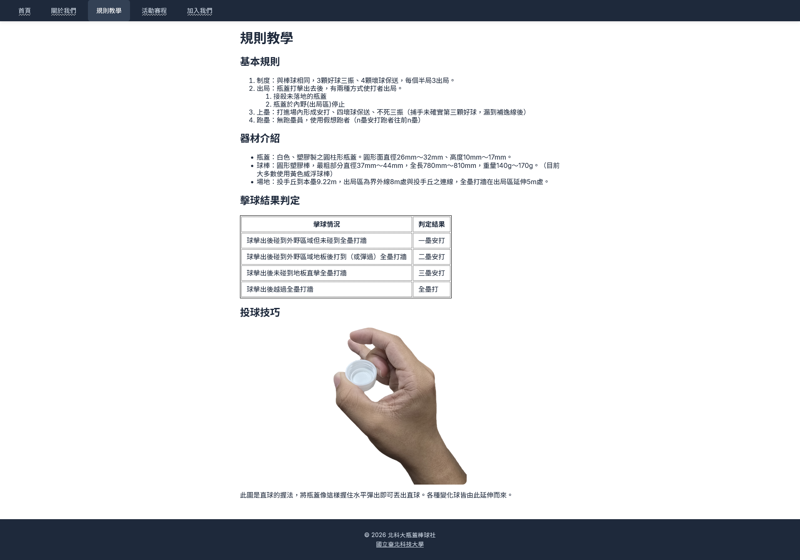
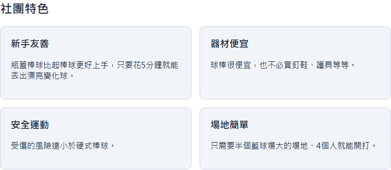
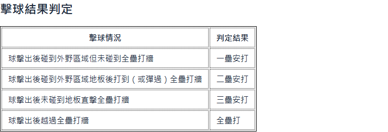
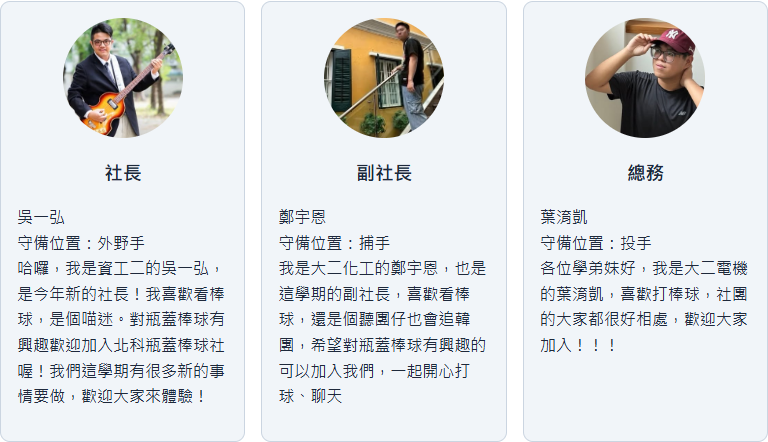
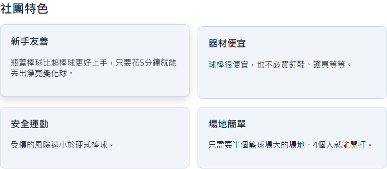

# NTUT Cap Baseball Club Website

- GitHub Repository: https://github.com/Good9tTo9t/webclass-midterm
- GitHub Pages: https://good9tto9t.github.io/webclass-midterm/

# A. Project Introduction

## (a.) What is the purpose of your website?

The purpose of this website is to introduce cap baseball to potential members. It also explains the basic rules of the game, lets members see when the next practice will take place, and shows interested people how to join.

## (b.) Who are the intended users?

1. **Potential members:** NTUT students who are still looking for a club to join.
2. **Current members:** people who are already in the club. For them, the website is a hub for all the latest information.

## (c.) Why did you choose this topic?

I am the president of this club, and I want to let more people know about our club and what we do. Cap baseball is still relatively unknown, so I would like to introduce it to more people. The website can also answer common questions, such as how to join and how much the membership fee is.

# B. Website Structure

## (a.) The purpose of each HTML page

### Home (`index.html`)


The purpose of this page is to impress visitors with the hero image at the top, followed by a basic introduction to the sport and the club.

### About Us (`about.html`)


This page introduces the history of our club, then the club officers, and finally provides links to our social media.

### Rules (`rules.html`)



This page explains the basic rules of the game and teaches visitors how to throw a basic fastball.

### Schedule (`schedule.html`)


This page shows club members the weekly practice time and recent game results, and includes a countdown clock to the next practice.

### Join Us (`join.html`)


This page explains how to join our club and shows the membership fee. There is also a short quiz about the club and the rules of the game.

## (b.) How users navigate between pages

Users can move between pages by using the navigation bar at the very top of every page. The active tab is in a different color so users know which page they are on.

# C. HTML and CSS Explanation

## (a.) HTML elements

### 1. `<nav>`


```html
<nav class="navbar" aria-label="主選單">
  <ul class="nav-list">
    <li class="nav-item"><a href="index.html" class="nav-link active" aria-current="page">首頁</a></li>
    <li class="nav-item"><a href="about.html" class="nav-link">關於我們</a></li>
    <li class="nav-item"><a href="rules.html" class="nav-link">規則教學</a></li>
    <li class="nav-item"><a href="schedule.html" class="nav-link">活動賽程</a></li>
    <li class="nav-item"><a href="join.html" class="nav-link">加入我們</a></li>
  </ul>
</nav>
```

The nav bar is simply an unordered list styled to display horizontally. It lets visitors jump between all pages of the site.

### 2. `<div>` (2×2 grid)



```html
<div class="grid-2x2">
  <div class="grid-cell">
    <h3>新手友善</h3>
    <p>瓶蓋棒球比起棒球更好上手，只要花5分鐘就能丟出漂亮變化球。</p>
  </div>
  <div class="grid-cell">...</div>
  <div class="grid-cell">...</div>
  <div class="grid-cell">...</div>
</div>
```

This grid shows some brief promotional information. Basically, it is one big div with `display: grid;` and four smaller divs inside it.

### 3. `<table>`



```html
<table>
  <thead>
    <tr>
      <th>擊球情況</th>
      <th>判定結果</th>
    </tr>
  </thead>
  <tbody>
    <tr>
      <td>球擊出後碰到外野區域但未碰到全壘打牆</td>
      <td>一壘安打</td>
    </tr>
    ...
  </tbody>
</table>
```

This table shows how a hit is judged in cap baseball. A table fits well here since each hit has a situation and a result. `<table>` wraps the entire table, `<thead>` contains the header, and `<tbody>` holds the actual data. `<tr>` is one row, and `<th>` is a header cell (which is centered by default), and `<td>` is a normal data cell.

## (b.) CSS properties

### 1. `display: grid` / `grid-template-columns`


```css
.grid-2x2 {
    display: grid;
    grid-template-columns: 1fr 1fr;
    grid-template-rows: auto auto;
    gap: 1rem;
}
```

`display: grid;` makes the outermost div a grid container, and `grid-template-columns: 1fr 1fr;` splits it into two columns of equal width (fr is short for fraction). The last two lines makes the card move down to the next line if the screen is too small. 

### 2. `display: flex` / `flex-wrap`



```css
.officer-list {
    display: flex;
    flex-wrap: wrap;
    gap: 1rem;
}

.officer-card {
    flex: 1;
    min-width: 200px;
}
```

For the officer cards, I used flexbox. `display: flex;` puts the three cards side by side in a row. `flex: 1;` lets each card take up an equal amout of space. `flex-wrap: wrap;` and `min-width: 200px;` moves the card down to the next line if the screen is too small. 

### 3. `:hover` / `transition`



```css
.grid-cell {
    transition: transform 0.2s, box-shadow 0.2s;
}

.grid-cell:hover {
    transform: translateY(-4px);
    box-shadow: 0 6px 16px rgba(0, 0, 0, 0.15);
}
```

When the mouse hovers over the cell, `transform: translateY(-4px);` moves the cell up a little bit, and `box-shadow: 0 6px 16px rgba(0, 0, 0, 0.15);` adds some shadow, so the cell looks like a physical object floating. `transition: transform 0.2s, box-shadow 0.2s;` just smooths it so it doesn't jut out suddenly.

# D. JavaScript Explanation

## Feature 1: Cap Baseball Quiz


### What the feature does

This is a short quiz with four questions about the club and rules of the sport. After answering, visitors click submit and can see the results under every question, and a score is presented. The reset button resets the question to an unanswered state. 

### Code

```js
const submitButton = document.getElementById("quiz-submit");
const resetButton = document.getElementById("quiz-reset");
const result = document.getElementById("quiz-result");

if (submitButton) {

  submitButton.addEventListener("click", function () {
    const questions = document.querySelectorAll(".quiz-question");
    let score = 0;

    for (let i = 0; i < questions.length; i++) {
      const question = questions[i];
      const answer = question.dataset.answer;
      const chosen = question.querySelector("input:checked");
      const feedback = question.querySelector(".quiz-feedback");

      if (chosen === null) {
        feedback.textContent = "你還沒作答喔！";
        feedback.className = "quiz-feedback wrong";
      } else if (chosen.value === answer) {
        score = score + 1;
        feedback.textContent = "答對了！";
        feedback.className = "quiz-feedback correct";
      } else {
        feedback.textContent = "答錯了，再看看規則教學頁吧！";
        feedback.className = "quiz-feedback wrong";
      }
    }

    result.textContent = "你答對了 " + score + " / " + questions.length + " 題";
  });

  resetButton.addEventListener("click", function () {
    const inputs = document.querySelectorAll(".quiz-question input");
    for (let i = 0; i < inputs.length; i++) {
      inputs[i].checked = false;
    }

    const feedbacks = document.querySelectorAll(".quiz-feedback");
    for (let i = 0; i < feedbacks.length; i++) {
      feedbacks[i].textContent = "";
      feedbacks[i].className = "quiz-feedback";
    }

    result.textContent = "";
  });
}
```

### How the code works

When "submit answers" is clicked, a for loop goes through every question. Every div has a `data-answer` attribute, which stores the correct answer. The code finds the radio button selected and compares with that. 

### How JavaScript interacts with the HTML elements

- `getElementById` finds where to show the result, the submit button, and the reset button.
- `querySelectorAll(".quiz-question");` finds the questions. 
- `dataset.answer` grabs the correct answer stored in the HTML file.
- `textContent` changes the feedback text. 
- `className` switches the feedback text to `correct` or `wrong`. 

## Feature 2: Countdown to Next Practice


### What the feature does

On the schedule page, there is a countdown clock showing how long until the next practice. It updates every second. If practice is happening right now, it says "practice is going on" instead.

### Code

```js
const countdownDisplay = document.getElementById("countdown-display");

function updateCountdown() {
  const now = new Date();

  if (now.getDay() === 1 && now.getHours() >= 19 && now.getHours() < 21) {
    countdownDisplay.textContent = "現在正在練習中，快來球場！";
    return;
  }

  const nextPractice = new Date();
  const daysToMonday = (1 - now.getDay() + 7) % 7;
  nextPractice.setDate(now.getDate() + daysToMonday);
  nextPractice.setHours(19, 0, 0, 0);

  if (nextPractice < now) {
    nextPractice.setDate(nextPractice.getDate() + 7);
  }

  const diff = nextPractice - now;
  const days = Math.floor(diff / (1000 * 60 * 60 * 24));
  const hours = Math.floor(diff / (1000 * 60 * 60)) % 24;
  const minutes = Math.floor(diff / (1000 * 60)) % 60;
  const seconds = Math.floor(diff / 1000) % 60;

  countdownDisplay.textContent = days + " 天 " + hours + " 小時 " + minutes + " 分 " + seconds + " 秒";
}

if (countdownDisplay) {
  updateCountdown();
  setInterval(updateCountdown, 1000);
}
```

### How the code works

First we get the current time with `new Date()`. If we are currently practicing (Monday 19:00~21:00), it shows the message "currently practicing" and the script stop. Otherwise, it works out how many days until monday with `(1 - now.getDay() + 7) % 7` and sets the time of the date to 19:00. If the time has already passed, we add 7 days to it. We now subtract the time now from the practice time to get the difference in milliseconds, and convert that to days, hours, minutes, and seconds with division and mod. 

### How JavaScript interacts with the HTML elements

The HTML has an empty `<p id=:"coutdown-display">`. JavaScript grabs it with `getElementById` and updates the countdown with `textContent` every second.

## Feature 3: Dynamic Copyright Information


### What the feature does

The footer of every page contains a copyright information along with a year. The year updates by itself, so I don't have to update it every year.

### Code

```js
const copyrightFooter = document.getElementById("copyright");
copyrightFooter.innerHTML = "&copy; " + new Date().getFullYear() + " 北科大瓶蓋棒球社";
```

### How the code works

We first use `getElementById` to find the Footer element. Then we use `new Date().getFullYear()` to get the current year and put it into the footer with `innerHTML`.

### How JavaScript interacts with the HTML elements

Every page has an empty `<p id="copyright">` in the footer. JavaScript finds it using `getElementById` and fills it using `innerHTML`. We use `innerHTML` here instead of `textContent` becuase we need to use `&copy; `.

# E. Reflection

## (a.) What was the most challenging part of this project?

I think it's coming up with the concept. I had a good idea of what I want to do, but hard time deciding what to write on each page. I turned to generative AI and it helped me write a basic skeleton of what to do on each page.

## (b.) What did you learn?

I think I've developed a good vibe-coding workflow with this project. I started with a homework from previous lectures, and let the agent take care of the boring parts. I still don't think letting agents start from scratch is a good idea. LLM also helped a lot by choosing colors for me, becuase trust me I suck at that!

## (c.) What would you improve if you had more time?

- I would probably let users sign up straight through the website instead of guiding them to other sites. 
- The navbar now stacks vertically on a phone. It'd be nice if it collapses into a hamburger menu.
- It'd be nice if we could load game results from a site (eg. [CAP-SCOREBOOK](https://cap-scorebook.com/)) or a file here. 