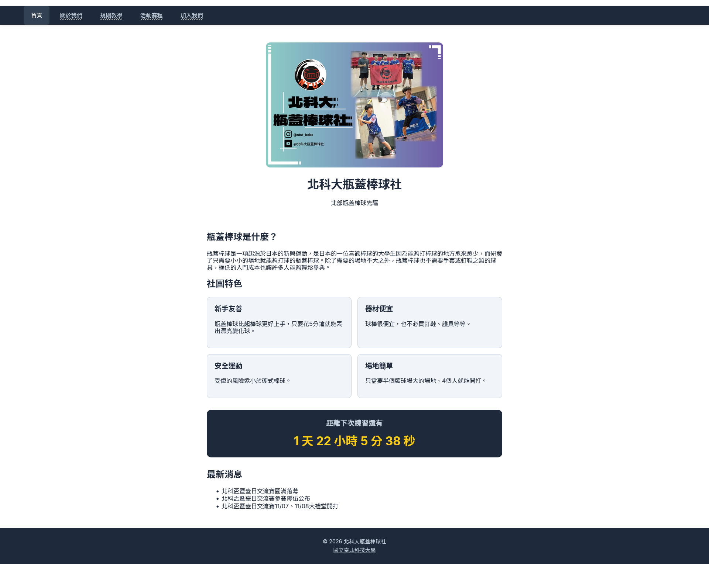
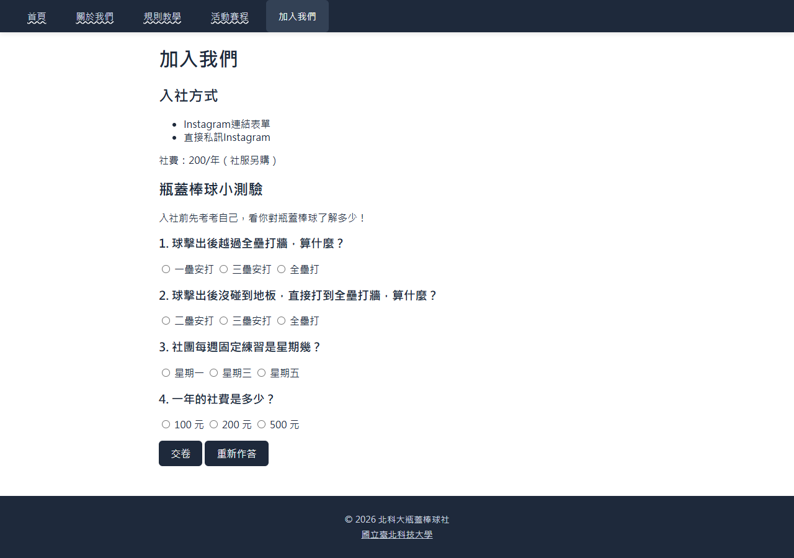
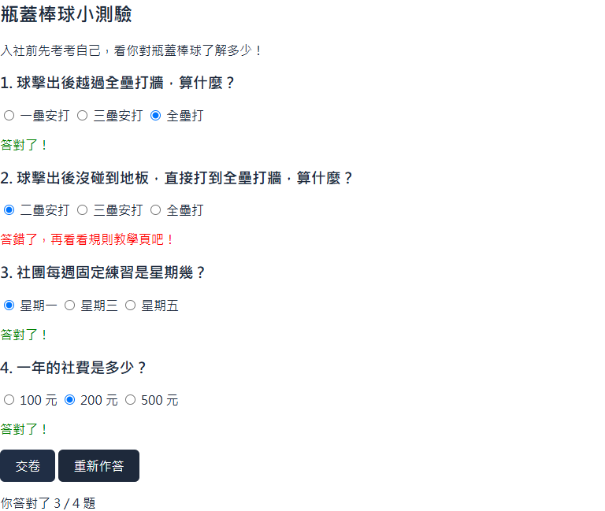

# NTUT Cap Baseball Club Website

- GitHub Repository: https://github.com/Good9tTo9t/webclass-midterm
- GitHub Pages: https://good9tto9t.github.io/webclass-midterm/

# A. Project Introduction

## (a.) What is the purpose of your website?

The purpose of this website is to introduce cap baseball to potential members. It also explains the basic rules of the game, lets members see when the next practice will take place, and shows interested people how to join.

## (b.) Who are the intended users?

1. **Potential members:** NTUT students who are still looking for a club to join.
2. **Current members:** people who are already in the club. For them, the website is a hub for all the latest information.

## (c.) Why did you choose this topic?

I am the president of this club, and I want to let more people know about our club and what we do. Cap baseball is still relatively unknown, so I would like to introduce it to more people. The website can also answer common questions, such as how to join and how much the membership fee is.

# B. Website Structure

## (a.) The purpose of each HTML page

### Home (`index.html`)



The purpose of the page is to impress the visitors with the hero image atop, along with some basic introduction of the sport and the club.

### About Us (`about.html`)


This page introduces the history of our club, then introduces the officers of the club, and finally some liks to our social media.

### Rules (`rules.html`)


This page explains the basics rules of the game, and teaches visitors how to throw a basic fastball.

### Schedule (`schedule.html`)


TODO

### Join Us (`join.html`)



TODO

## (b.) How users navigate between pages

TODO

# C. HTML and CSS Explanation

## (a.) HTML elements

### 1. TODO

### 2. TODO

### 3. TODO

## (b.) CSS properties

### 1. TODO

### 2. TODO

### 3. TODO

# D. JavaScript Explanation

## Feature 1: Cap Baseball Quiz



### What the feature does

TODO

### Code

```js
```

### How the code works

TODO

### How JavaScript interacts with the HTML elements

TODO

## Feature 2: Countdown to Next Practice


### What the feature does

TODO

### Code

```js
```

### How the code works

TODO

### How JavaScript interacts with the HTML elements

TODO

## Feature 3: Dynamic Copyright Information


### What the feature does

TODO

### Code

```js
```

### How the code works

TODO

### How JavaScript interacts with the HTML elements

TODO

# E. Reflection

## (a.) What was the most challenging part of this project?

TODO

## (b.) What did you learn?

TODO

## (c.) What would you improve if you had more time?

TODO
