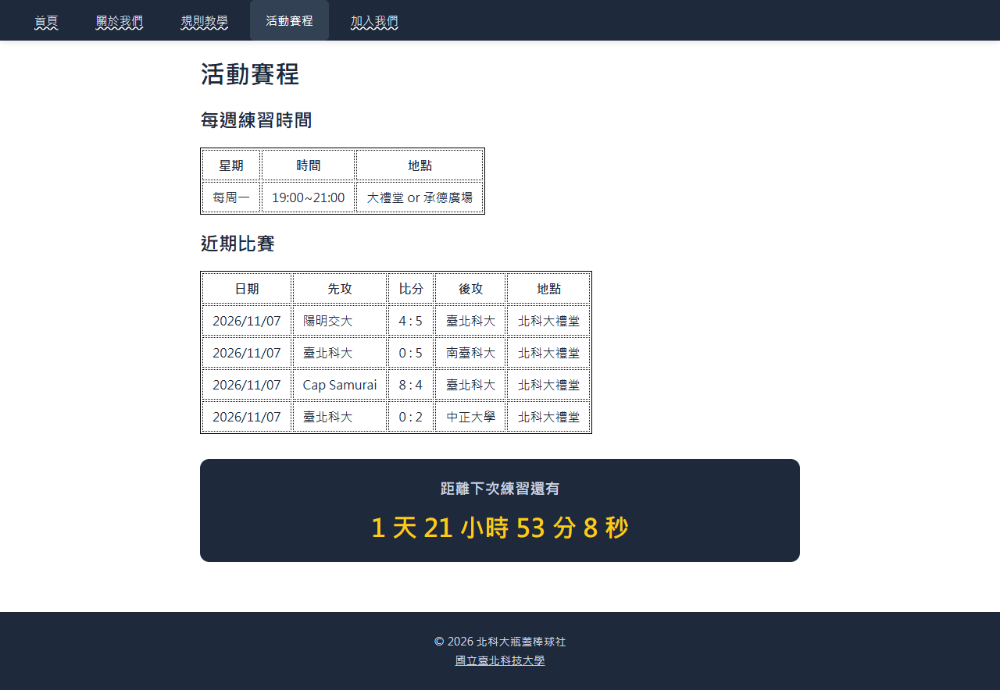
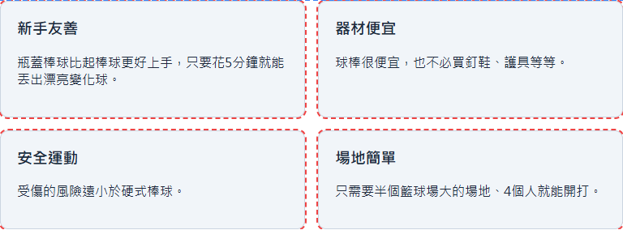

# NTUT Cap Baseball Club Website

- GitHub Repository: https://github.com/Good9tTo9t/webclass-midterm
- GitHub Pages: https://good9tto9t.github.io/webclass-midterm/

# A. Project Introduction

## (a.) What is the purpose of your website?

The purpose of this website is to introduce cap baseball to potential members. It also explains the basic rules of the game, lets members see when the next practice will take place, and shows interested people how to join.

## (b.) Who are the intended users?

1. **Potential members:** NTUT students who are still looking for a club to join.
2. **Current members:** people who are already in the club. For them, the website is a hub for all the latest information.

## (c.) Why did you choose this topic?

I am the president of this club, and I want to let more people know about our club and what we do. Cap baseball is still relatively unknown, so I would like to introduce it to more people. The website can also answer common questions, such as how to join and how much the membership fee is.

# B. Website Structure

## (a.) The purpose of each HTML page

### Home (`index.html`)


The purpose of this page is to impress visitors with the hero image at the top, followed by a basic introduction to the sport and the club.

### About Us (`about.html`)


This page introduces the history of our club, then the club officers, and finally provides links to our social media.

### Rules (`rules.html`)


This page explains the basic rules of the game and teaches visitors how to throw a basic fastball.

### Schedule (`schedule.html`)



This page shows club members the weekly practice time and recent game results, and includes a countdown clock to the next practice.

### Join Us (`join.html`)


This page explains how to join our club and shows the membership fee. There is also a short quiz about the club and the rules of the game.

## (b.) How users navigate between pages

Users can move between pages by using the navigation bar at the very top of every page. The active tab is in a different color so useres know which page they're on. 

# C. HTML and CSS Explanation

## (a.) HTML elements

### 1. `<nav>`


```html
<nav class="navbar" aria-label="主選單">
  <ul class="nav-list">
    <li class="nav-item"><a href="index.html" class="nav-link active" aria-current="page">首頁</a></li>
    <li class="nav-item"><a href="about.html" class="nav-link">關於我們</a></li>
    <li class="nav-item"><a href="rules.html" class="nav-link">規則教學</a></li>
    <li class="nav-item"><a href="schedule.html" class="nav-link">活動賽程</a></li>
    <li class="nav-item"><a href="join.html" class="nav-link">加入我們</a></li>
  </ul>
</nav>
```

The nav bar is just an unordered list stylized horizontally. It lets visitor jump between all pages of the site. 

### 2. `<div>` (2×2 grid)


```html
<div class="grid-2x2">
  <div class="grid-cell">
    <h3>新手友善</h3>
    <p>瓶蓋棒球比起棒球更好上手，只要花5分鐘就能丟出漂亮變化球。</p>
  </div>
  <div class="grid-cell">...</div>
  <div class="grid-cell">...</div>
  <div class="grid-cell">...</div>
</div>
```

TODO

### 3. `<table>`


```html
<table>
  <thead>
    <tr>
      <th>擊球情況</th>
      <th>判定結果</th>
    </tr>
  </thead>
  <tbody>
    <tr>
      <td>球擊出後碰到外野區域但未碰到全壘打牆</td>
      <td>一壘安打</td>
    </tr>
    ...
  </tbody>
</table>
```

TODO

## (b.) CSS properties

### 1. `display: grid` / `grid-template-columns`



```css
.grid-2x2 {
    display: grid;
    grid-template-columns: 1fr 1fr;
    grid-template-rows: auto auto;
    gap: 1rem;
}
```

TODO

### 2. `display: flex` / `flex-wrap`


```css
.officer-list {
    display: flex;
    flex-wrap: wrap;
    gap: 1rem;
}

.officer-card {
    flex: 1;
    min-width: 200px;
}
```

TODO

### 3. `:hover` / `transition`


```css
.grid-cell {
    transition: transform 0.2s, box-shadow 0.2s;
}

.grid-cell:hover {
    transform: translateY(-4px);
    box-shadow: 0 6px 16px rgba(0, 0, 0, 0.15);
}
```

TODO

# D. JavaScript Explanation

## Feature 1: Cap Baseball Quiz


### What the feature does

TODO

### Code

```js
```

### How the code works

TODO

### How JavaScript interacts with the HTML elements

TODO

## Feature 2: Countdown to Next Practice


### What the feature does

TODO

### Code

```js
```

### How the code works

TODO

### How JavaScript interacts with the HTML elements

TODO

## Feature 3: Dynamic Copyright Information


### What the feature does

TODO

### Code

```js
```

### How the code works

TODO

### How JavaScript interacts with the HTML elements

TODO

# E. Reflection

## (a.) What was the most challenging part of this project?

TODO

## (b.) What did you learn?

TODO

## (c.) What would you improve if you had more time?

TODO
